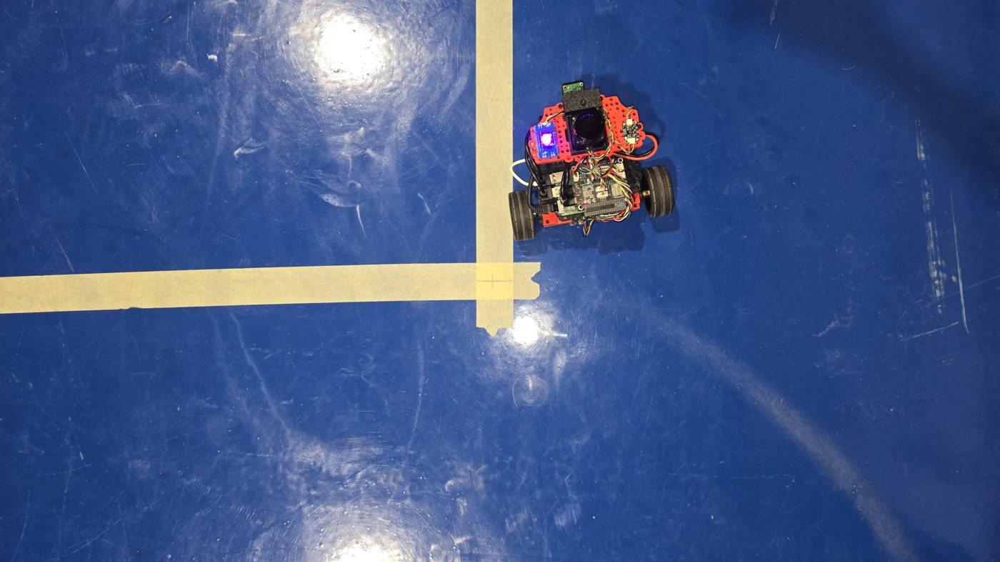

# Learn2Race – Prototype A

Prototype A is the racing robot of the Learn2Race project. It follows a black line with a downward-looking camera and runs the ISEP Robotics Open **TrackBotGP** races and the **Dragster** event. It also serves as a teaching platform. The Raspberry Pi 4 runs ROS 2 Jazzy, and an ESP32 handles the wheels over micro-ROS.

<p align="center">
  
  
</p>
<p align="center">
  
</p>

## Hardware

| Part | Detail |
|---|---|
| Computer | Raspberry Pi 4, Ubuntu 24.04 Server, ROS 2 Jazzy |
| Motor controller | ESP32 on the Waveshare General Driver for Robots, micro-ROS over USB serial (921 600 baud) |
| Motors | 2 × CHP-20GP-180ABHL (1:29.16, 11 PPR encoders, 1283 counts per wheel turn), rear drive, printed ball castor |
| Line camera | Raspberry Pi Camera v2 (IMX219), 65 mm above the floor, axis about 53° below horizontal, 41.8 fps |
| Track light | ring of 20 WS2813 LEDs around the camera, on the Pi's SPI |
| Start light sensor | LTR-303 on the top plate |
| IMU | QMI8658C on the driver board, read by the Pi (Madgwick filter) |
| Lidar | LDROBOT LD06/STL-06P (off during races) |
| Status LED | P9813 chainable RGB LED |
| Size and mass | 180 × 206 × 158 mm, 1021 g with a 3S LiPo |

The robot is 206 mm wide across the wheels, which is 6 mm over the TrackBotGP limit of 200 mm. Narrower tyres (15–17 mm) are planned. The current wheels were kept for the tests so that every result comes from one configuration.

## Repository layout

| Path | Contents |
|---|---|
| [`firmware/`](firmware/README.md) | ESP32 firmware (PlatformIO, micro-ROS): wheel speed control, odometry, LED |
| [`learn2race_ws/`](learn2race_ws/README.md) | ROS 2 Jazzy workspace that runs on the Pi |
| [`tools/`](tools/) | `robot.sh` (run helper), ROS graph export, topic statistics |
| [`docs/references.md`](docs/references.md) | References cited in the code headers as `[Rnn]` |
| [`photos/`](photos/) | Photographs of the robot |

## Documentation

- [INSTALL.md](INSTALL.md): preparing the Raspberry Pi, building the workspace and flashing the ESP32.
- [USAGE.md](USAGE.md): running practice and races, the packages and their launch files, and the tools.
- Each ROS package has its own `README.md` under `learn2race_ws/src/`.

## Quick start (robot already installed)

```bash
ssh learn2race@<robot address>
~/robot.sh practice 0.3                         # follow the line at 0.3 m/s
~/robot.sh race trackbotgp 0.5 track:=portimao  # a TrackBotGP race
~/robot.sh attach                               # watch the logs (Ctrl+b, then d to leave)
~/robot.sh stop
```

The PC-side tools (gamepad driving, RViz, Gazebo replay) are in the **Learn2Race-PC-Control** repository.

## Author

Ruben Pereira, ISEP – Instituto Superior de Engenharia do Porto (MSc dissertation, 2026).
